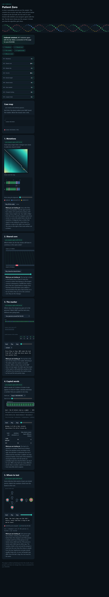

# Assignment 4. Patient Zero

Student ID: 254042
Name: Balyasnyy Alisher
Group: SE-2510

This file is the report. Fill it in as you go. How to start: `START_HERE.md`. The task: `docs/Assignment4.pdf`.

## Program output

The 9 lines your program prints on your data (`java -cp out Main`):

    Mutations: 89
    Shared core: 1001
    Marker hits: 4
    First hit: 10446
    Border length: 3
    Shared words: 391
    Tests needed: 44
    Cheapest testing: 173
    Longest chain: 37

My outbreak report (a screenshot of `output/outbreak.html`):

## Questions

Answer in your own words, two or three sentences each.

Mission 1. What does the cell d[i][j] of your table mean, and how is it computed from other cells?
The cell d[i][j] shows the minimum number of changes to make the first part of string A equal to the first part of string B. If the letters are the same, we take the diagonal value. If they are different, we add 1 to the smallest value from delete, insert, or replace.

Mission 2. How is the longest common subsequence different from the longest common substring? My Shared core is bigger than the number of letters that are the same at the same place: why?
A subsequence has letters in the same order, but the letters do not need to be next to each other. A substring has letters next to each other. My Shared core is bigger because the algorithm can find the same letters in different positions in the two strings.

Mission 3. What does the prefix function tell you, and why does the pointer in the text never go back in KMP? What is the Border length of my marker and what does it mean?
The prefix function shows how many letters at the start are the same as letters at the end. In KMP, the text pointer does not go back because the algorithm uses this function to continue searching. My Border length is 3, so my marker has 3 letters at the start that are also at the end.

Mission 4. Why must you compare the letters after the hashes are equal? What happens to the cost of Rabin-Karp if many windows have the same hash?
Two different words can have the same hash. This is called a hash collision. We must compare the letters to be sure that the words are really the same. If many windows have the same hash, the algorithm needs more time to compare them.

Mission 5. What are the two states of a person in your DP, and how do you get the answer for a person from its children? Why does a greedy "test the person with most links first" not always give the cheapest answer?
Each person has two states: tested or not tested. If a person is not tested, all children must be tested. If a person is tested, we choose the cheaper option for each child. The greedy method does not always work because the person with the most links may have a high test cost, and it does not check the best solution for the whole tree.
## AI use

I used ChatGPT for this assignment.

To understand the algorithms.

To learn how the five missions work.

To find and fix mistakes in my Java code.

To check my code and understand the test results.

To prepare for the assignment quiz.

I tested my program with the examples and my own data. I also used ChatGPT explanations to understand my code and prepare for the defense.

## Timing (Mission 7)

Milliseconds, average of 3 runs, from `java -cp out Bench`.

| test | size | time                      |
|---|---|---------------------------|
| naive search | 20 000 / 40 000 / 80 000 | 59,7ms/90.4ms/185.7ms     |
| KMP | 20 000 / 40 000 / 80 000 | 0.2ms/0.0ms,/0.0ms        |
| edit distance | 500 / 1000 / 2000 / 4000 | 5.3ms/8.8ms/20.2ms/78.8ms |

What do the numbers say about how the time grows? When you double the size, by how much does each time grow? Two or three sentences.
The naive search becomes slower as the text size increases, approximately doubling from 40,000 to 80,000 characters. KMP is much faster in these tests; its displayed time is 0.0 ms for the larger inputs because it is below the output precision. Edit distance becomes significantly slower as the strings grow: from 2,000 to 4,000 characters, the time increases from 20.2 ms to 78.8 ms, approximately four times, which is consistent with quadratic growth.

## Complexity

n is the length of the text (or of a strain), m the length of the pattern, k the length of the window, v the number of people. Fill in every algorithm you wrote.

| algorithm | time  | space | assumptions |
|---|-------|-------|-------------|
| Edit distance | O(n * m) | O(n * m) |  Uses a two-dimensional DP table.  |
| LCS | O(n * m) | O(n * m) |    Uses a two-dimensional DP table.         |
| Prefix function and KMP | O(n + m) | O(m + z) |    z is the number of matches returned; the prefix table uses O(m) space.         |
| Rabin-Karp (shared words) | O(n + m) | O(n)  |        Uses rolling hashes and a hash map; actual characters are compared to verify collisions. Worst-case time can be higher if many windows have the same hash.     |
| Tree DP | O(v)  | O(v)  |      The infection network is a tree; DFS visits every vertex and edge a constant number of times.       |

## Before you submit

- The four files in `data` and the screenshot `output/outbreak.png` are in the repository.
- `java tools/Check.java` shows all examples right.
- This README is filled in, the program output and the section AI use included.
- The work is pushed to main (at least one commit per mission) and the repository is public.
- The link is attached in Moodle.
